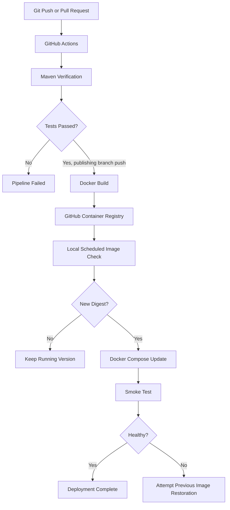

# Aris — Architecture

## Overview

Aris is a single-instance workflow automation backend built with Java 21 and Spring Boot.

Its architecture separates HTTP request handling, application services, workflow execution, domain models, and relational persistence.

## Main Components

### REST API

`WorkflowController` exposes workflow creation and retrieval.

`ExecutionController` allows manual execution requests and execution status retrieval.

Request DTOs use Jakarta Bean Validation for input constraints.

### Application Service

`WorkflowService` coordinates workflow creation, persistence, scheduling, and manual execution submission.

Manual executions use an asynchronous execution pool.

The pool has four worker threads and a bounded waiting queue.

### Workflow Scheduler

`WorkflowScheduller` uses an in-memory priority queue ordered by the next execution time.

It restores eligible scheduled workflows from PostgreSQL during application startup.

The scheduler runs on a dedicated worker thread.

Scheduling is interval-based, despite the internal trigger name `CRON`.

### Workflow Executor

`WorkflowExecutor` processes workflow steps in order.

Each step can define:

- Action type
- Configuration
- Maximum retry count
- Retry backoff

A failing step can cause subsequent steps to be skipped.

Execution logs record the outcome of each attempt.

### Action Executors

Actions implement the `ActionExecutor` interface.

Current implementations:

- `LogMessageExecutor`
- `HttpRequestExecutor`

HTTP actions are disabled by default and require explicit trusted-host configuration.

### Persistence

The application uses repository interfaces with Spring JDBC implementations.

PostgreSQL stores:

- Workflows
- Workflow steps
- Executions
- Execution logs

Flyway manages the relational schema.

Repository operations use transactions where applicable.

## CI/CD Architecture

The local staging updater is pull-based and checks the published image digest.

Rollback is limited to attempting to restore the previous application image. Database migrations are not automatically reversed.

## Data Consistency

JDBC repositories use transactional operations for persistence.

This does not guarantee exactly-once processing of external actions.

A failed or interrupted process may leave an execution in an intermediate persisted state.

The project does not implement a distributed execution lease, transactional outbox, or distributed scheduler coordination.

## Scalability Constraints

The scheduler is designed for a single running application instance.

Multiple instances sharing the same database could schedule the same workflow without a distributed coordination mechanism.

The asynchronous execution pool is bounded, but the scheduled execution worker does not use the same pool.

## Future Engineering Improvements

- API authentication and authorization
- Stronger SSRF prevention and network egress restrictions
- Recovery policy for interrupted executions
- Idempotency keys and duplicate-execution prevention
- Distributed scheduler coordination
- Metrics and observability
- Production deployment and operational monitoring
